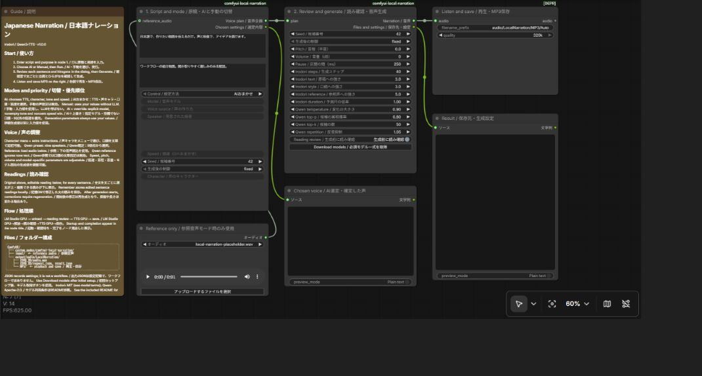
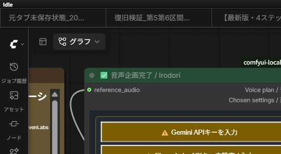
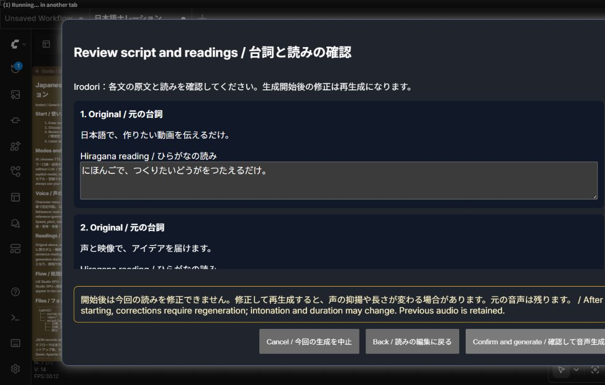

# Local Japanese Narration / 日本語おまかせナレーション

[Illustrated guide / 個別解説](https://note.com/happy_duck780/n/nda7ed302d544)

[](https://github.com/FURUYAN1234/ComfyUI-Local-Narration-Japanese/releases/download/v1.2.6/LocalNarration_v1.2.6.zip)

**Workflow package / ワークフロー配布ZIP:** Download and extract this package, then follow the installation instructions and model requirements in this README. / この配布ZIPをダウンロードして展開し、このREADMEの導入手順と必要なモデル・環境を確認してください。


**Source code is public and software use is free. Personal, business, internal and commissioned use, and free integration/provision require no application, prior contact or permission from FURU. Third-party and API terms remain separate. / ソースコード公開・利用無料。個人利用、業務、社内利用、受託制作、無料の組み込み・無料提供には、申請・事前連絡・FURUの許可は不要です。第三者とAPIの条件は別です。**

## Usage terms / 利用条件

> [!NOTE]
> **Current scope / 現行の適用範囲:** Local Narration v1.2.6: Apache-2.0 for the integration code and distributed workflow. / 連携コードと配布ワークフローはApache-2.0。
>
> Source code is public and software use is free. Personal, business, internal and commissioned use, and free integration/provision require no application, prior contact or permission from FURU. Third-party and API terms remain separate. / ソースコード公開・利用無料。個人利用、業務、社内利用、受託制作、無料の組み込み・無料提供には、申請・事前連絡・FURUの許可は不要です。第三者とAPIの条件は別です。
>
> You may publish, sell, monetize and deliver text, images, comics, videos and other outputs made with the software without application, individual permission, fees or attribution to FURU. / 道具として制作した文章・画像・漫画・動画等は公開・販売・収益化・納品できます。FURUへの申請・個別許可・利用料・クレジット表記は不要です。
>
> Free Web articles, paid note introductions, and independently authored explanations, reviews and courses require no permission, prior contact or fees to FURU if copies or modified versions of the software are not included in the product. / 無料Web記事、note等の有料紹介記事、独自の解説・レビュー・講座は、対象ソフトウェアの複製・改変版を商品に含めなければ、FURUへの許可・事前連絡・利用料は不要です。
>
> FURU permits screenshots and operation videos for introductions insofar as FURU can authorize them, and ordinary links to distribution pages. Check rights and conditions for third-party works, images, materials, audio and other content shown in them separately. / FURUが許諾できる操作画面・操作動画の紹介掲載と、通常の配布ページへのリンクを認めます。掲載した第三者の作品・画像・素材・音声等の権利と条件は別途確認してください。
>
> Free redistribution and integration must follow each applicable license: retain the required copyright/license/third-party notices and identify modifications where required. FURU asks services to make their applicable notices available on an accessible information page, without adding obligations beyond existing licenses. Do not falsely imply official FURU publication, endorsement or partnership. / 無料再配布・無料組み込みでは各適用ライセンスに従い、必要な著作権表示・許諾文・第三者ライセンスを保持し、該当する改変を明示してください。サービスでは利用者が確認できる説明ページに適用条件を案内することをお願いしますが、既存ライセンスを超える義務は追加しません。FURUの公式・公認・提携と偽って表示しないでください。
>
> Current MIT, Apache-2.0 and GPL-3.0 grants also allow software sales, paid distribution, integration into paid offerings, paid functionality and software copies in paid teaching materials or purchaser/member bonuses, subject to the respective license obligations. FURU prior permission is not additionally required for those licensed uses. The seven-app commercialization permission policy is not retroactively imposed on these already licensed projects. A third-party license, model or API may impose separate limits that FURU cannot waive. / 現行のMIT・Apache-2.0・GPL-3.0許諾では、各ライセンスの義務を満たせば、ソフトウェアの販売・有料配布、有料商品等への組み込み、機能の有料提供、有料教材・購入者限定特典・会員向け配布への複製同梱も認められます。その許諾内の利用へFURUの事前許可を追加で求めません。7アプリの商品化の事前許可方針を、既に許諾済みの本プロジェクトへ遡及適用しません。第三者ライセンス・モデル・APIには別の制限があり、FURUは免除できません。
>
> Advertising revenue or voluntary donations alone do not make software access paid in FURU's usage guidance. Internal-only integration, use as your own production tool, commissioned creation and sales/delivery of completed works do not require FURU permission. This does not redefine third-party NonCommercial terms; free access with advertising can still require a separate assessment under those terms. / FURUの利用案内では広告収益や任意の寄付だけでは機能の有料提供として扱いません。社内だけの組み込み、自分で道具として使う受託制作・完成作品の販売・納品にはFURUの許可は不要です。この区分は第三者の非商用条件の意味を変更せず、広告付きの無料提供なども第三者条件を別途判断してください。
>
> If you seek a separately negotiated permission beyond an applicable license, contact FURU with the project/version/files, use, recipients and charging arrangement. Permission is effective when FURU replies by email or another recorded method expressly granting permission and its scope. No paper contract or seal is needed. An inquiry, automatic reply or silence is not permission. The existing licensed uses above require no such inquiry. FURU cannot grant rights belonging to someone else. / 適用ライセンスの範囲外で個別の許可を求める場合は、プロジェクト・版・ファイル、利用方法、提供先、料金の有無を添えてFURUへお問い合わせください。FURUがメール等の記録に残る方法で許可の旨と対象範囲を返信すれば、その範囲で有効です。紙の契約書・押印は不要です。問い合わせ送信、自動返信、無応答だけでは許可になりません。前記の既存許諾内の利用には、この問い合わせは不要です。FURUは他者の権利を許可できません。
>
> Using the software alone does not give FURU rights in your outputs or apply software terms to those outputs. Copies or modified software included in an output remain separately subject to their applicable software licenses. Copyright eligibility/ownership, third-party rights, contracts and API provider terms must be assessed separately. / 利用しただけでFURUが成果物の権利を取得したり、ソフトウェア条件を成果物へ適用したりしません。成果物中のソフトウェア自体の複製・改変部分は、別途その適用ライセンスに従います。著作権の成立・帰属、第三者の権利、契約、API提供元の条件は別途判断してください。
>
> Valid previous MIT, GPL, Apache, Creative Commons and other grants are not revoked or narrowed. Previous releases, existing ZIPs and inherited licensed portions retain their existing permissions. This 2026-10-08 documentation revision clarifies the stated current source commits and designates no new software restrictions. A future change must identify the eligible version, files and rights holder and cannot take away valid earlier grants. / 過去に有効に付与されたMIT・GPL・Apache・Creative Commons等の許諾を取り消したり狭めたりしません。過去版・既存ZIP・従前の許諾を引き継ぐ部分は従来の許諾を保持します。2026-10-08の今回の文書改定は記載した現行ソースコミットの条件を明確化し、新たなソフトウェア制限は指定しません。将来変更する場合は適用可能な版・ファイル・権利者を明示し、以前の有効な許諾を狭めません。
>
> Model-specific and codec/watermark licenses, reference voice rights, and Gemini/ElevenLabs fees and terms remain separate. / モデル別条件、コーデック・透かしの条件、参照音声の権利、Gemini・ElevenLabsの料金と条件は別途適用されます。
>
> [Full guidance / 利用案内全文](FURU_TERMS.md) · [Version, files and rights holders / 版・ファイル・権利者](LICENSE_SCOPE.md) · [Existing LICENSE / 既存LICENSE](LICENSE)


One ComfyUI workflow for Irodori, Qwen3-TTS, Gemini 3.8 Flash TTS, Flash-Lite TTS and ElevenLabs, with AI/manual control and pronunciation review. / Irodori・Qwen3-TTS・Gemini 3.8 Flash TTS・Flash-Lite TTS・ElevenLabsを1本で切り替え、AIおまかせ・手動設定・生成前の読み確認を使えるComfyUIワークフローです。

The workflow uses a compact left-to-right layout: consultation and adopted inputs, generation, then the scrolling audio result list. / ワークフローは、相談・採用済み入力、生成、スクロール式の音声結果一覧を左から右へ並べます。

## Workflow overview / ワークフロー全体図



The first node is where you consult AI or adopt manual script and voice settings; the center node generates after the required reading review; the right node plays and saves the completed audio. / 左の最初のノードでAI相談または手動の台詞・声設定を採用し、中央のノードで必須の読み確認後に生成し、右のノードで完成音声を再生・保存します。

## Download / 入手

Download the ZIP from [Releases](https://github.com/FURUYAN1234/ComfyUI-Local-Narration-Japanese/releases/latest). / リリースからZIPを入手してください。
The ZIP includes the workflow, custom node and setup scripts; models are downloaded separately. / ZIPにはワークフロー・カスタムノード・セットアップ処理を同梱し、モデルは別途取得します。

## Requirements / 必要な環境

The supported setup is Linux or Ubuntu on WSL2, Python 3.10–3.12, NVIDIA CUDA GPU and a working ComfyUI installation. / 対象はLinuxまたはWSL2のUbuntu、Python 3.10〜3.12、NVIDIA CUDA GPU、導入済みのComfyUIです。
The tested configuration has 16 GB VRAM; this is not a guaranteed minimum. / 検証環境のVRAMは16GBです。必要最小量を保証する値ではありません。
Install Git, FFmpeg, SoX and venv support. / Git・FFmpeg・SoX・venvを用意してください。

```bash
sudo apt update
sudo apt install git ffmpeg sox python3-venv
```

AI consultation additionally needs LM Studio, its `lms` CLI and the `qwen/qwen3.5-9b` model. / AI相談ではLM Studio、lms CLI、qwen/qwen3.5-9bモデルも必要です。
Manual mode does not use LM Studio. / 手動モードではLM Studioを使いません。
Download the LLM inside LM Studio before using AI mode. / AI利用前にLM Studio側でLLMを取得してください。
`LOCAL_NARRATION_LMS_CLI` can point to the CLI, and `LOCAL_NARRATION_LM_ENDPOINT` can override the API URL. / CLIの場所とAPI接続先は左記の環境変数で指定できます。
Windows LM Studio is detected from its standard installation on WSL. / WSLではWindows版LM Studioの標準配置を検出します。
Gemini generation requires a Gemini API key and uses a cloud API for which charges may apply, but key registration is optional when using local Irodori or Qwen. The optional API button is the first control in the narration node. Saving a verified key closes the dialog automatically; the key is kept only in the running ComfyUI process memory and is never written to the workflow, output JSON or log. / Gemini生成にはGemini APIキーが必要で、クラウドAPIの利用料金が発生する場合がありますが、ローカルのIrodori・Qwenだけを使う場合、API登録は不要です。任意のAPI登録ボタンは音声企画ノードの最初に表示されます。認証して保存すると入力窓は自動で閉じ、キーは動作中のComfyUIプロセスのメモリだけに保持され、ワークフロー・出力JSON・ログへ保存されません。
ElevenLabs is also available in manual Voice settings. Set its separate API key, select a named voice from your available voices, and listen to its preview. The provider's preview may be in English; check Japanese pronunciation with generated narration. If the voice list cannot be retrieved, enter a Voice ID manually. The workflow uses Eleven Multilingual v2 for Japanese, sends approved text only after the reading review, and saves the resulting audio through the same output path. The key stays in ComfyUI process memory; generation uses your ElevenLabs credits. / ElevenLabsも手動の「声を確認・調整」で選べます。専用APIキーを設定し、利用可能な声を名前の一覧から選んで試聴します。提供元の試聴は英語の場合があり、日本語の発音は生成音声で確認します。一覧を取得できない場合はVoice IDを手入力できます。日本語対応のEleven Multilingual v2を使い、読み確認で承認した原稿を送信して、既存と同じ出力先へ保存します。キーはComfyUIプロセスのメモリ内だけに保持され、生成時にElevenLabsのクレジットを使用します。

API status buttons show **⚠️ when the key is missing** and **✅ when it is configured for this ComfyUI session**. The ElevenLabs key dialog also warns when unset. Local Irodori/Qwen works without either cloud key. / APIボタンは**未設定なら⚠️、このComfyUIセッションに設定済みなら✅**を表示します。ElevenLabsのキー入力窓にも未設定の警告を表示します。ローカルIrodori・Qwenだけなら、どちらのクラウドキーも不要です。



When Gemini TTS is selected, the narration text, voice/style instructions and generation settings are sent to the Gemini API. Do not submit sensitive, confidential or personal information through unpaid Gemini services; Google states that unpaid-service inputs and outputs may be used for product improvement and reviewed by humans, while paid-service data handling differs. Review the current Gemini API terms before use. / Gemini TTSを選ぶと、原稿・声や口調の指示・生成設定がGemini APIへ送信されます。Googleは、無償サービスの入出力を製品改善に利用し、人手で確認する場合があるため、機密情報・個人情報を無償サービスへ送信しないよう案内しています。有償サービスではデータの扱いが異なります。利用前に最新のGemini API規約を確認してください。

## Install / 導入

Extract the ZIP, open its directory in Ubuntu, and replace the example ComfyUI path with yours. / ZIPを展開し、Ubuntuで展開先を開いて、例のComfyUIパスを自分の配置先に置き換えます。

```bash
python3 install.py --comfyui /path/to/ComfyUI
```

The installer creates separate environments for the two incompatible Transformers versions. / 互換性の異なるTransformersを分離するため、2つの専用環境を作ります。
Initial setup downloads Python packages and CUDA libraries and may take time and substantial disk space. / 初回はPythonパッケージとCUDAライブラリを取得するため、時間とディスク容量を使います。
Restart ComfyUI and open `03_音声/18_音声_ローカルナレーション/日本語ナレーション_TTS切替_AI・手動`. / ComfyUIを再起動し、左記のワークフローを開きます。
Press **Download models / 必須モデル一式を取得** on the generation node. / 音声生成ノードのモデル取得ボタンを押してください。
It downloads pinned Irodori, codec, watermark and Qwen model files; cached files are reused. / 指定版のIrodori・コーデック・透かし・Qwenモデルを取得し、取得済みファイルは再利用します。
Status appears in the node title, and failures are shown instead of reporting success. / ノード見出しに進捗を表示し、失敗時はエラーを表示します。
For CLI download after setup: / セットアップ後に端末で取得する場合：

```bash
/path/to/ComfyUI/custom_nodes/comfyui-local-narration/runtime/envs/irodori/bin/python \
  /path/to/ComfyUI/custom_nodes/comfyui-local-narration/runtime/download_models.py
```

Reference OFF requires no audio file. / 参照OFFでは音声ファイルは不要です。
Enable the separate reference node and upload suitable reference speech to use it. / 別の参照ノードをONにし、参照する発話音声をアップロードして使用します。

## Use / 使い方

1. Optional: register a Gemini or ElevenLabs API key with the corresponding button only when using that cloud service. / 任意：クラウド音声を使う場合だけ、該当するGeminiまたはElevenLabsのボタンからAPIキーを登録します。
2. Review or set the current voice in Voice settings, then consult AI when you want a script or voice proposal. / 「声を確認・調整」で現在の声を確認・設定し、台詞や声の提案が必要な場合はAIに相談します。
3. Review and edit the proposed script and voice in the dialog, then Apply. / 小窓で提案された台詞と声を確認・修正し、採用します。
4. Confirm the adopted script and voice shown on the node. / ノード上の採用済み台詞と声を確認します。
5. Run, approve the original text and readings, then generate. / 実行し、原文と読みを承認してから生成します。
6. Play and save full audio or individual sentences in the final scrolling list. / 最後のスクロール一覧で全体・台詞別の音声を再生・保存します。

For a fully manual start, type directly in the adopted-script field or use Edit script → Voice settings → Run and review readings; this route does not open AI consultation. / すべて手入力する場合は、採用済み台詞欄へ直接入力するか「台詞を1文ずつ編集」→「声を確認・調整」→「実行して読みを確認」の順に操作し、AI相談は使いません。

The generation node has **Sentence silence / 全体音声の台詞間の無音（ms）**. It adds 800 ms of silence between each sentence only in the full narration; individual sentence MP3 files remain unchanged. Increase or decrease it in 50 ms steps to suit the video. / 音声生成ノードの **全体音声の台詞間の無音（ms）** は、全体音声だけで各台詞の間に800msの無音を入れます。台詞別MP3は変わりません。動画に合わせて50ms単位で調整できます。

### Consultation draft and adoption / 相談の下書きと採用

Choose whether AI updates both script and voice, only the script, or only the voice; the other item stays unchanged. Once a voice has been adopted, script-only is the default, so Voice settings need not be repeated. / AIが更新する対象を「台詞と声」「台詞だけ」「声だけ」から選び、対象外の設定は維持します。声を採用済みなら台詞だけが初期選択となり、声設定を繰り返す必要はありません。
Without a sentence count, a new script defaults to five sentences with an introduction, concrete explanation and conclusion; explicit counts take priority. A deficient draft gets one automatic correction attempt. / 文数指定がなければ、新規原稿は導入・具体的な説明・まとめを含む5文を基本にし、明示した文数を優先します。文数などが不適合なら一度だけ自動で修正を求めます。
A final editorial pass expands weak drafts and removes unsupported assumptions about named works, settings and recent events. This uses the local model, not external source verification. / 下書きの後に校閲を行い、内容不足や、未指定の作品・設定・最近の動向の推測を見直します。ローカルモデルによる校閲であり、外部資料の照合ではありません。
For example, ask for five lines of narration. The proposal shows editable lines and voice settings; Apply transfers them to the node's sentence list and voice settings together. / 例えば「ナレーションを5行作って」と相談すると、編集できる台詞と声の提案を表示します。採用すると台詞一覧と声の設定へまとめて反映します。
Choosing an example fills the editable request field; only that request is sent to AI. There is no separate permanent purpose field on the node. / 依頼文の例を選ぶと編集可能な依頼欄へ入力され、AIにはその依頼文だけが送られます。ノード上に別の用途欄は置きません。
The proposal is a draft until adopted. Cancelling leaves existing inputs intact. / 提案は採用するまで下書きです。キャンセルしても元の入力は変わりません。
After submission, the dialog closes and the progress banner remains visible. The same dialog can be reopened from the node while waiting; when the proposal or error arrives, it reopens for review. Cancelling a pending consultation discards its result; computation may still finish in the background. / 送信後は窓を閉じ、画面上部に経過表示を残します。待機中はノードから同じ窓を開き直せます。提案完了・エラー時は窓が戻ります。待機中にキャンセルすると結果を採用せず、計算自体は終了まで続く場合があります。
Consultation status and elapsed time remain visible while the dialog is closed. / 小窓を閉じている間も相談状況と経過時間を表示します。

### Script and voice editing / 台詞と声の編集

Edit script uses one sentence per field, with Add, Remove and removal restore. Save updates both the node preview and the generated sentence list. / 台詞編集は1枠1文で、追加・削除・削除の取消ができます。保存するとノードの表示と生成対象の台詞一覧を同時に更新します。
The adopted-script field is directly editable. Copy, Paste, Clear, Undo and Redo stay in one compact row; typing, pasting and clearing immediately update the sentence list. Undo/Redo also support Ctrl/Cmd+Z, Ctrl+Y and Ctrl/Cmd+Shift+Z. / 採用済み台詞欄は直接編集できます。コピー・ペースト・クリア・戻す・やり直すを小さな1行にまとめ、入力・貼り付け・クリアは台詞一覧へ即時反映します。戻す・やり直すはCtrl/Cmd+Z、Ctrl+Y、Ctrl/Cmd+Shift+Zにも対応します。
When the script is empty, the node Run button is disabled and explains that a script is required. Restoring or entering text enables it again. / 台詞が空の間はノードの実行ボタンを無効にし、台詞が必要であることを表示します。文字を入力または戻すと再び実行できます。
Voice settings shows the adopted voice and lets you select or revise it. AI consultation proposes settings from your request; applying the proposal makes it the adopted voice. / 「声を確認・調整」は採用済みの声を表示し、選択・変更できます。AI相談は希望から設定を提案し、提案を採用するとその声が採用済みの声になります。
Edit voice offers model, character and tone presets; choosing Custom tone reveals a shared voice/tone text field. Seed controls are under Advanced. / 声の編集ではモデル・キャラクター・口調のプリセットを選べます。口調の「自由入力」で声質・口調の文章欄を表示します。候補番号は詳細設定へまとめています。
Voice gender offers Auto, Female, Male and Any in both the manual voice dialog and AI consultation. Female/Male filter the Qwen speakers, Gemini studio voices and voice-design presets into labeled groups. Any shows both groups. Auto leaves the AI free to choose; in the manual dialog it uses the current tone's gender when specified. A reference recording or saved Voice ID determines its own voice, so check it before use. / 声の性別は手動の声設定とAI相談の両方で「自動・女性・男性・任意」から選べます。女性・男性はQwen話者、Gemini公式声、声イメージの候補を性別ごとに絞り、任意では両方を表示します。自動はAI相談では用途から選び、手動では口調の性別指定を参照します。参照音声と保存済みVoice IDはその音声自体で決まるため、使用前に確認してください。
Gemini can use Flash for fidelity and expressive acting or Flash-Lite for speed and cost efficiency. Both expose all 30 official studio voices, 20 Voice Design image presets, a free-form Voice Design description, an existing `voice_...` ID, automatic emotion, emotion presets, intensity and free-form acting directions. AI selection uses a safe Voice Design preset; selecting `自由入力` reveals its text field. An empty custom description is rejected in both the UI and generation backend without sending an API request. / Geminiは品質・演技重視のFlashと速度・コスト重視のFlash-Liteを選択できます。両方で公式スタジオボイス30種、Voice Design用の声イメージ20プリセット、Voice Designの自由入力、既存の`voice_...` ID、感情の自動設定・プリセット・強度・自由入力を使用できます。AI選択時は安全な声イメージプリセットを使い、`自由入力`を選ぶと記述欄が現れます。自由入力が空欄なら、API送信前にUIと生成バックエンドの双方で止めます。
AI consultation includes both Gemini models only while a Gemini API key is registered in the current ComfyUI session. Manual selection remains available; selecting Gemini without a key opens the API dialog and keeps the previous model if the dialog is cancelled. / AI相談では、このComfyUIセッションにGemini APIキーが登録されている間だけGeminiの2モデルを候補へ加えます。手動選択も可能で、未登録時にGeminiを選ぶとAPI窓が開き、閉じた場合は元のモデルへ戻ります。
Run uses the adopted settings without another AI selection. Older workflows with undecided automatic settings must first adopt an AI proposal or a voice preset. / 実行では採用済みの設定を使い、AIによる再選定は行いません。旧ワークフローの未確定のおまかせ設定は、先にAI提案か声のプリセットを採用してください。
Original script text is retained; approved readings go to TTS. Reading approval cannot be bypassed. / 原稿は保持し、承認した読みをTTSへ渡します。読み承認は省略できません。
Save the workflow to retain adopted inputs and output file references. / 採用した入力と音声の参照情報を残すには、ワークフローを保存してください。
Reference audio is configured in the separate ON/OFF node. Disable reference audio before adopting a newly designed AI voice. Qwen reference/preset voices do not use voice-design text. / 参照音声は別ノードのON/OFFで設定します。AIで提案した新しい声を採用する場合は参照をOFFにしてください。Qwenの参照声・既定話者では声のデザイン文章を使いません。

## Many audio files / 音声が多い場合

Audio bytes stay in the ComfyUI output directory; the workflow retains file references. / 音声の実体はComfyUIのoutputフォルダーへ保存され、ワークフローにはファイルの参照情報を保持します。
The completed-audio node uses the height allocated to its node and scrolls internally for the full track and every sentence, with an MP3 download link for each. / 完成音声ノードは割り当てられたノードの高さを使い、全体音声と全台詞を内部スクロールで表示し、それぞれのMP3を保存できます。
All sentences stay in the scrolling list; audio loads on playback. / 全台詞をスクロール一覧に保持し、音声は再生時に読み込みます。
While a new run is waiting for reading approval or generating, retained audio is marked as the previous result. When the new result arrives, the list header changes to the current completed generation and shows its timestamp. / 新しい実行が読み確認待ちまたは生成中は、残っている音声を前回の結果として表示します。新しい結果が届くと、一覧の見出しを今回の生成完了と生成日時へ切り替えます。
Saving the workflow does not embed or copy audio files. Keep the corresponding output folder when moving to another computer. / ワークフローの保存は音声の埋め込み・コピーを行いません。別PCへ移す場合は対応する出力フォルダーも保持してください。

## Pronunciation review / 読み確認



Every sentence appears with the original above and editable hiragana below. / 全文を文ごとに、原文が上・編集できるひらがなが下に表示します。
Automatic conversion can misread names or context-dependent words; correct them before generation. / 自動変換は人名や文脈で読みが変わる語を誤る場合があるため、生成前に修正してください。
The memory checkbox saves edited sentence readings locally for reuse. / 記憶チェックで修正した文の読みをローカル保存し、次回に再利用します。
A confirmation warns that changes after generation starts require a new generation. / 開始前に、開始後の修正は再生成になることを確認します。
Regeneration may change intonation and duration; previous audio files remain. / 再生成で抑揚や長さが変わる場合があります。元の音声ファイルは残ります。
Cancel is on the left and Generate on the right. Cancelling is a normal interruption: it keeps existing audio and does not report a generation error. / 中止は左、生成は右に配置しています。中止は通常の中断として扱い、既存音声を残し、生成エラーとしては表示しません。

## Tuning and outputs / 調整と出力

Adjust speed, pitch, volume, pauses, Irodori steps/guidance, Qwen sampling and Gemini emotion/acting. / 話速・音程・音量・間・Irodoriのステップと各強度・Qwenのサンプリング・Geminiの感情と演技を調整できます。
Engine-specific settings affect only the selected engine. / モデル固有の設定は該当モデルだけに作用します。
Long text is split; subsequent designed-voice chunks use the first generated voice as reference. / 長文は分割し、声のデザイン時は最初の声を後続区間の参照に使います。
LM Studio runs on GPU and releases it before TTS generation. / LM StudioをGPUで実行し、解放してからTTSを生成します。

```text
ComfyUI/
├─ custom_nodes/comfyui-local-narration/
│  └─ runtime/
│     ├─ config.json
│     ├─ envs/
│     └─ private/narration_readings.json
├─ input/                         # reference audio / 参照音声
├─ user/default/workflows/03_音声/18_音声_ローカルナレーション/
└─ output/audio/LocalNarration/
   ├─ 日時_ID/                    # audio.wav, request.json, result.json
   └─ MP3/                        # playback and download / 再生・保存
```

Output JSON files record the script, readings, settings and result; they are not workflow JSON. / 出力JSONは原稿・読み・設定・結果の記録で、ワークフローとして読み込むものではありません。
Keep generated WAV as a future voice reference. / 生成WAVを次回の声の参照に利用できます。
Do not include personal dictionaries, input audio or local configuration when redistributing. / 再配布時は個人の辞書・入力音声・ローカル設定を含めないでください。

## Models and licenses / モデルとライセンス

Integration code: Apache-2.0. / 連携コードはApache-2.0です。

- [Irodori-TTS v4.1-Small](https://huggingface.co/Aratako/Irodori-TTS-v4.1-Small): MIT; follow the model card's additional usage restrictions, including consent for impersonation. / MIT。なりすましに関する同意要件など、モデルカードの追加利用条件も確認してください。
- [Qwen3-TTS](https://github.com/QwenLM/Qwen3-TTS): 1.7B VoiceDesign, CustomVoice and Base; Apache-2.0. / 1.7BのVoiceDesign・CustomVoice・Baseを使用。Apache-2.0です。
- [Gemini 3.8 Flash TTS and Flash-Lite TTS](https://ai.google.dev/gemini-api/docs/speech-generation): cloud API models; usage, pricing, generated-audio SynthID and Google terms apply. / クラウドAPIモデルで、利用条件・料金・生成音声のSynthID・Googleの規約が適用されます。
- [Gemini API Additional Terms](https://ai.google.dev/gemini-api/terms): data handling differs between unpaid and paid services; never include API keys or confidential/personal information in shared workflows or prompts. / 無償・有償サービスでデータの扱いが異なります。共有ワークフローやプロンプトへAPIキー・機密情報・個人情報を含めないでください。
- [Irodori inference code](https://github.com/Aratako/Irodori-TTS), [DACVAE](https://github.com/facebookresearch/dacvae), [SilentCipher](https://github.com/SesameAILabs/silentcipher): downloaded from their projects; licenses remain with them. / 各プロジェクトから取得し、それぞれのライセンスが適用されます。

## Validation / 検証

For v1.2.6, the missing-key warning was checked in the actual ComfyUI screen; missing/configured transitions and provider calls were checked with automated mocks. Paid generation was not rerun for this UI change. / v1.2.6では実際のComfyUI画面で未設定警告を確認し、未設定・設定済みの切替とAPI連携をモック検査しました。この表示変更では有料音声生成を再実行していません。

Real GPU runs covered Irodori, Qwen preset/reference, long-text voice reuse and LM Studio automatic selection. / 実GPUでIrodori・Qwen既定話者と参照・長文の声再利用・LM Studio自動選択を検証しています。
Gemini request construction, Flash/Flash-Lite routing, API-key redaction, credential-dialog closure, 30-voice selection and emotion settings have automated coverage. Live API generation completed for both Gemini models through the normal ComfyUI path, and both results appeared in the final playback/save node. / Geminiの要求形式、Flash/Flash-Lite分岐、APIキー秘匿、認証窓の自動終了、30音声選択、感情設定は自動検査しています。Geminiの2モデルは通常のComfyUI経路で実API生成し、どちらも最終の再生・保存ノードへ表示されることを確認しています。
Pronunciation still requires listening; ASR matching alone does not prove naturalness. / 発音は試聴が必要です。ASR一致だけで自然さを保証しません。
The initial environment setup was checked with existing compatible environments; a different PC may require CUDA or system-package adjustments. / 初期設定は既存の互換環境を指定して検証しており、別PCではCUDAやシステムパッケージの調整が必要な場合があります。
For v1.2.4, live ComfyUI consultations returned both a voice-only proposal and a one-sentence script proposal after the dialog closed and reopened; no test proposal was adopted. / v1.2.4では、ComfyUI実画面で声のみと台詞1文のAI提案が戻り、送信後に閉じた窓の再表示を確認しました。検証用の提案は採用していません。
For v1.2.3, the sentence-edit button text is vertically centered in the compact first-node layout. / v1.2.3では、最初のノードの「台詞を1文ずつ編集」ボタンの文字を縦中央に揃えました。
For v1.2.2, the reading review also includes a private per-word user dictionary. Add, edit or delete a word and its hiragana reading; matching words take priority over sentence memory in new conversions. During an open review, updated suggestions replace only rows the user has not manually edited. / v1.2.2では読み確認に非公開の単語辞書を追加しました。単語とひらがなの読みを登録・編集・削除できます。辞書にある語は新しい読み変換で文単位の記憶より優先し、確認中は手修正していない行だけ候補を更新します。
For v1.2.2, changing Female/Male in Voice settings updates an opposite-gender term in the custom tone while keeping the rest of the text. The Apply button also aligns a pre-existing unambiguous mismatch, saves the selected settings and closes the dialog. A mixed male/female instruction is still held for manual correction. This behavior was checked in the live ComfyUI editor and regression tests. / v1.2.2では、声の性別を切り替えると自由入力の逆の性別語だけが更新され、他の口調は保持されます。既に食い違った設定も、明確に一方の性別だけなら「採用」で整合して保存・閉じます。男女が混在する指示は手動修正を求めます。ComfyUI実画面と回帰テストで確認しました。
For v1.2.1, manual Female/Male/Any/Auto menus and both gender-specific Qwen preset voices were checked in the live ComfyUI workflow. Male and female AI proposals and an automatic ComfyUI consultation completed; opposite-gender instructions were rejected. The two short Qwen test MP3 files were generated and saved, but their audible quality was not assessed. / v1.2.1では、手動の女性・男性・任意・自動メニューを実際のComfyUI画面で確認し、Qwenの男女話者で短いMP3を生成・保存しました。男女指定のAI提案とComfyUI経由の自動相談も完了し、矛盾する性別指定は拒否されました。音声の聴感品質は未評価です。

## Version / バージョン

v1.2.6: shows ⚠️ for missing ElevenLabs keys and ✅ for configured sessions, including the key dialog. The downloadable ZIP includes the v1.2.5 ElevenLabs integration. / v1.2.6ではElevenLabsのキー未設定を⚠️、設定済みを✅で表示し、入力窓にも状態を示します。配布ZIPにはv1.2.5のElevenLabs対応を含みます。

v1.2.5: adds optional ElevenLabs narration, voice-list selection and preview, custom Voice ID input, and session-only API key handling. / v1.2.5ではElevenLabsの任意の音声生成、声一覧からの選択と試聴、Voice IDの自由入力、セッション限定のAPIキー管理を追加しました。


v1.2.4: closed the consultation dialog after sending, reopened it for results, and kept the adopted voice by default in later script consultations. / v1.2.4ではAI相談の送信後に窓を閉じ、結果で再表示し、採用済みの声があるときは台詞のみの相談を初期選択にしました。

v1.2.3: centered the sentence-edit button label in the first node. / v1.2.3では最初のノードの台詞編集ボタンの文字位置を修正しました。

v1.2.2: fixed Voice settings adoption when the custom tone still names the previously selected gender, and added a private per-word reading dictionary. / v1.2.2では、自由入力の口調に前の性別が残った場合も声設定を採用できるようにし、非公開の単語読み辞書を追加しました。

v1.2.1: added gender selection to manual settings and AI consultation, organized Qwen and Gemini voice menus by gender, and extended the local AI response timeout for slow consultations. / v1.2.1では、手動設定とAI相談に声の性別選択を追加し、Qwen・Geminiの声候補を性別ごとに整理しました。時間のかかるローカルAI相談の応答待ち上限も延長しました。

v1.2.0: added optional Gemini 3.8 Flash/Flash-Lite TTS, a session-only API dialog, 30 studio voices, 20 Voice Design presets plus free-form design and existing Voice ID, API-aware AI selection, and automatic/manual emotion control. The node order is API registration, Voice settings, then AI consultation; Gemini remains optional for local Irodori/Qwen use. / v1.2.0では、Gemini 3.8 Flash/Flash-Lite TTSの任意選択、セッション限定API入力窓、公式音声30種、Voice Design用プリセット20種＋自由入力・既存Voice ID、API登録状態に連動するAI選択、感情の自動・手動設定を追加しました。ノードの操作順はAPI登録→声の確認→AI相談とし、ローカルのIrodori・Qwenだけを使う場合はGemini登録不要です。

v1.1.5: AI consultation waits for the LM Studio API and model readiness instead of waiting for the CLI command to exit; an idle retained model is reused. / v1.1.5では、AI相談時にLM Studio CLIの終了を待たず、APIとモデルの準備完了を確認します。待機中でない既存モデルは再利用します。

v1.1.4: made the adopted-script area directly editable, added compact copy/paste/clear/undo/redo controls, and disabled the node Run button while the script is empty. / v1.1.4では、採用済み台詞欄を直接編集できるようにし、コピー・ペースト・クリア・戻す・やり直すを追加しました。台詞が空の間はノードの実行ボタンを無効にします。

v1.1.3: full narration now inserts 800 ms of silence between sentences by default. This affects only the combined full track; per-sentence MP3 files are unchanged. Regenerate the narration to apply a changed silence value to audio. / v1.1.3では、全体音声に台詞ごと800msの無音を標準で入れます。台詞別MP3は変わりません。間の設定を変更したあとは、音声を再生成して反映します。

v1.1.2: when narration is saved as per-sentence audio, the first generated design voice is retained as the reference for every later sentence. This keeps one speaker and delivery across the narration; Qwen built-in speakers and user reference audio remain fixed as before. / 台詞別MP3を作る場合も、最初の文で生成したデザイン声を後続の全台詞の参照声として保持し、ナレーション全体で話者・話し方を統一します。Qwenの用意された話者とユーザー指定の参照音声は従来どおり固定です。

v1.1.1: renamed the voice button to “Voice settings / 声を確認・調整” and documented the fully manual route, so an adopted AI voice is clearly an editable current setting, not an additional manual-selection step. / AIが提案して採用した声も現在の設定として確認・変更できることが伝わるよう、声のボタンを「Voice settings / 声を確認・調整」へ変更し、全手入力の手順を記載。

v1.1.0: redesigned draft/adopt consultation, unified sentence/voice editing, targeted progress notifications, the node Run shortcut, normal reading-review cancellation, and current-versus-previous audio result labels. / 相談の下書きと採用、台詞・声の編集、対象を絞った進行通知、ノード上の実行ボタン、通常の読み確認中止、今回・前回の音声結果表示を追加しました。

v1.0.0: unified TTS selection, AI/manual control, character menu, reading review and model download. / TTS切替・AI/手動・声キャラメニュー・読み確認・モデル取得を統合。

## Other apps and workflows / その他のアプリ・ワークフロー

[AI Manga Creative Suite overview / AIまんが制作エコシステムの全体案内](https://note.com/happy_duck780/n/nbdf826604ce7)

| Tool / ツール | Purpose / 用途 | Links / リンク |
| --- | --- | --- |
| Super FURU AI 4-koma System / Super FURU AI 4コマシステム | Manga generation / 漫画生成 | [GitHub](https://github.com/FURUYAN1234/nano-banana-pro) · [Guide / 解説](https://note.com/happy_duck780/n/ndf063558c1f5) |
| AI Image Bridge / クリスタ用AI画像編集プラグイン | Edit CLIP STUDIO PAINT layers with AI / クリスタのレイヤーをAIで編集 | [GitHub](https://github.com/FURUYAN1234/ai-image-bridge) · [Guide / 解説](https://note.com/happy_duck780/n/n6747a089fce7) |
| AI Story Maker / AI物語メーカー | Story and plot creation / 物語・プロット作成 | [GitHub](https://github.com/FURUYAN1234/story-maker) · [Guide / 解説](https://note.com/happy_duck780/n/nd3d972922868) |
| AI Character Sheet Maker / AIキャラクターシートメーカー | Character reference sheets / キャラクター資料作成 | [GitHub](https://github.com/FURUYAN1234/character-sheet-maker) · [Guide / 解説](https://note.com/happy_duck780/n/neccbebd7d957) |
| AI Comic Translation Tool / AI漫画翻訳ツール | Manga translation / 漫画翻訳 | [GitHub](https://github.com/FURUYAN1234/comic-translation) · [Guide / 解説](https://note.com/happy_duck780/n/ne462dfc55ec8) |
| PanoForge / 360度AIパノラマ生成ツール | 360-degree backgrounds / 360度背景生成 | [GitHub](https://github.com/FURUYAN1234/panoforge) · [Guide / 解説](https://note.com/happy_duck780/n/nb53b121fef88) |
| AI Voice Comic Maker / AI音声コミックメーカー | Voiced comic videos / 漫画の音声付き動画化 | [GitHub](https://github.com/FURUYAN1234/ai-voice-comic-maker) · [Guide / 解説](https://note.com/happy_duck780/n/ndc6533c1512f) |
| Monogatari Buzz Maker / 物語バズメーカー | Trend research and creative planning / 話題調査・創作企画 | [GitHub](https://github.com/FURUYAN1234/viral-radar) · [Guide / 解説](https://note.com/happy_duck780/n/ncc593101d77f) |
| Narrated Video Maker / ナレーション動画メーカー | Narrated videos with subtitles and BGM / ナレーション・字幕・BGM付き動画 | [GitHub](https://github.com/FURUYAN1234/gemini-narration-studio) · [Guide / 解説](https://note.com/happy_duck780/n/n97d49c1c98b1) |
| MiniMax H3 Video / MiniMax H3動画生成 | T2V, I2V and Ref2V workflows / 文章・開始画像・参照画像から動画生成 | [GitHub](https://github.com/FURUYAN1234/comfyui-h3-workflows) · [Guide / 解説](https://note.com/happy_duck780/n/n15e732b3147b) |
| MiniMax H3 MV / MiniMax H3ミュージックビデオ | Music videos from completed songs / 完成曲からMV制作 | [GitHub](https://github.com/FURUYAN1234/comfyui-h3-workflows) · [Guide / 解説](https://note.com/happy_duck780/n/ne8a84cb6db37) |
| KomaOrbit / 一枚絵から3D構図を探すツール | Explore viewpoints and export images / 視点の調整・画像出力 | [GitHub](https://github.com/FURUYAN1234/comfyui-h3-workflows) · [Guide / 解説](https://note.com/happy_duck780/n/n3f68482d5edd) |
| Long Video AnimeSharp Upscaler / 長尺動画AnimeSharpアップスケーラー | Video upscaling with audio retention / 音声を保持して動画を拡大 | [GitHub](https://github.com/FURUYAN1234/comfyui-long-video-upscaler) · [Guide / 解説](https://note.com/happy_duck780/n/n0f190160e307) |
| Japanese Song Creation / 日本語おまかせ作曲（LM Studio × YuE2） | Lyrics and song creation / 歌詞・歌の制作 | [GitHub](https://github.com/FURUYAN1234/ComfyUI-YuE2-Japanese) · [Guide / 解説](https://note.com/happy_duck780/n/n57df44cf7fd2) |
| MangaScreen JP / 日本語操作・原寸出力対応版 | Manga lines, fills and screentones / 漫画の線画・ベタ・網点処理 | [GitHub](https://github.com/FURUYAN1234/ComfyUI-MangaScreen-JP) · [Guide / 解説](https://note.com/happy_duck780/n/n5c89a250fb82) |
| Codex Usage / Codex 残量 | Windows usage overlay / Windows用の利用枠表示ツール | [GitHub](https://github.com/FURUYAN1234/codex-usage-overlay) · [Guide / 解説](https://note.com/happy_duck780/n/n98e53f17d74a) |
| Local Handoff MCP / ローカルの作業引き継ぎ | Resume work between Codex and Antigravity in the same project folder / 同じ作業フォルダーでCodexとAntigravityの作業を引き継ぐ | [GitHub](https://github.com/FURUYAN1234/local-handoff-mcp) · [Guide / 解説](https://note.com/happy_duck780/n/n806c7bc6de94) |
| AI Tracer Nazori-kun / AIトレーサー なぞり君 | Replay inking and original-color fills in a browser / ブラウザーでペン入れと元色の彩色を再生 | [Web app / 公開アプリ](https://furuyan1234.github.io/ai-tracer-nazori-kun/) · [GitHub](https://github.com/FURUYAN1234/ai-tracer-nazori-kun) · [Guide / 解説](https://note.com/happy_duck780/n/n75301de9493a) |
